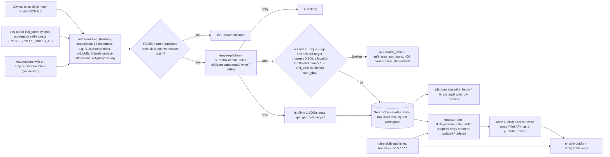

# 01 — Business process (As-Is / To-Be)

life-roles-skills-api คือ cell "Roles and skills" ที่เก็บบทบาทส่วนตัวของ owner, skill และหมวด skill, learning path ของแต่ละ role, progress log และการผูก role กับ goal, project, context, task รวมถึง allocation ของ role ต่อโปรเจกต์ owner และ automation เรียกผ่าน API ด้วย token ของ empire-platform ส่วน cell ส่ง graph events ของ personal role, skill และ progress entry ไปที่ platform

Last reviewed: 2026-11-27 · commit `43ca70c`

## As-Is (จากโค้ดวันนี้)

Sources: `cell.yaml`, `migrations/0002_progress_log.sql`, `.railway/railway.ts`, `pyproject.toml` (platform-cellkit v1.0.11: `cellkit/app.py`, `cellkit/auth.py`, `cellkit/publisher.py`, `cellkit/server.py`), `README.md`, `PRODUCT.md`

ข้อเท็จจริงสำคัญจากโค้ด:

- เฉพาะ `personal-role`, `skill` และ `progress-entry` (`/v1/progress-log`) มี `graph` ใน `cell.yaml` จึงเขียน outbox; link, category, path step และ allocation ไม่ส่ง event
- `role_id` เป็น text id ของ role ใน registry `ROLE-CATALOG` ไม่ใช่แถวใน cell นี้; `goal_id`, `project_id`, `context_id`, `task_id` เป็นเลขธรรมดา ไม่ใช่ foreign key
- range rule มีเฉพาะ `role-project-allocation` (`start_date`..`end_date`); allocation ที่ไม่มี `goal_id` ไม่ถูกกันซ้ำ และไม่ตรวจว่า allocation ของ role รวมกันได้ 100
- `role-goal-link.allocation_percent` ไม่มีขอบเขต min/max ใน `cell.yaml` (ต่างจาก `role-project-allocation`)
- การสร้างแบบ import (มี `legacy_id`) ต้องมีสิทธิ์ `roles-skills.<resource>:admin` เพิ่มจาก `:write`; create รับ `Idempotency-Key`, patch ใช้ `expected_version`
- owner token (ไม่มี delegation) อายุได้ไม่เกิน 1 ชั่วโมง, delegated token ไม่เกิน 30 วัน
- API มี publisher token สำหรับ inline publish หรือไม่: README ระบุ `ROLES_SKILLS_PUBLISHER_TOKEN` เฉพาะ publisher [ต้องยืนยัน]; ถ้าไม่มี event จะรอ cron รอบถัดไป
- การตรวจ `X-Gateway-Assertion` (edge gateway) เปิดตาม `GATEWAY_ASSERTION_MODE`; ค่าใน production [ต้องยืนยัน]

## To-Be (จาก PRODUCT.md §Measures)

ไม่มี spec ที่ค้างอยู่ (`specs/001-l2-baseline` approved และ implement แล้ว) และไม่มีภาพกระบวนการเป้าหมายที่เขียนไว้ สิ่งที่เขียนไว้มีเพียง measures ที่ "Proposed, nothing collects them yet":

- role ที่ active มี link ไปยัง goal, project หรือ task อย่างน้อยหนึ่ง
- skill ที่มี progress entry ใน 30 วันล่าสุด
- allocation ที่ active แต่ `end_date` ผ่านไปแล้ว (เป้า: 0)
- 5xx rate และ p95 latency ของ `/v1/skills` (Sentry และ uptime worker)

## Gap

| ID | As-Is → To-Be | Status | Owner | Evidence |
|---|---|---|---|---|
| G1 | `PRODUCT.md` บอกว่า publisher cron ทุก 15 นาที แต่ `.railway/railway.ts` ตั้ง `5 * * * *` (ชั่วโมงละครั้ง) → เอกสารตรงกับ config | todo | claude | `PRODUCT.md` §Operating Context; `.railway/railway.ts` |
| G2 | measures เป็นแค่ข้อเสนอ ไม่มีอะไรเก็บ (รวม allocation ที่หมดอายุแต่ยัง active) → owner อนุมัติ measures และเลือกที่เก็บ | decide | owner | `PRODUCT.md` §Measures |
| G3 | ไม่มี To-Be ของกระบวนการ (เช่น การตรวจ allocation รวม 100, การตรวจ id ข้าม cell) → owner กำหนด | decide | owner | ไม่มีใน `PRODUCT.md` / `specs/` |

## Open questions

- มีหน้าเว็บที่แสดง roles หรือ skills หรือไม่ (`PRODUCT.md` ระบุ [ต้องยืนยัน])
